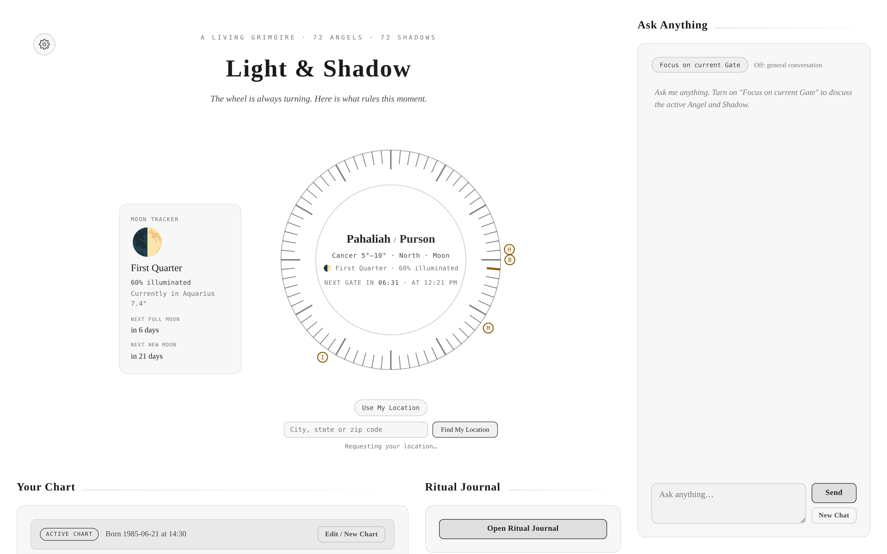
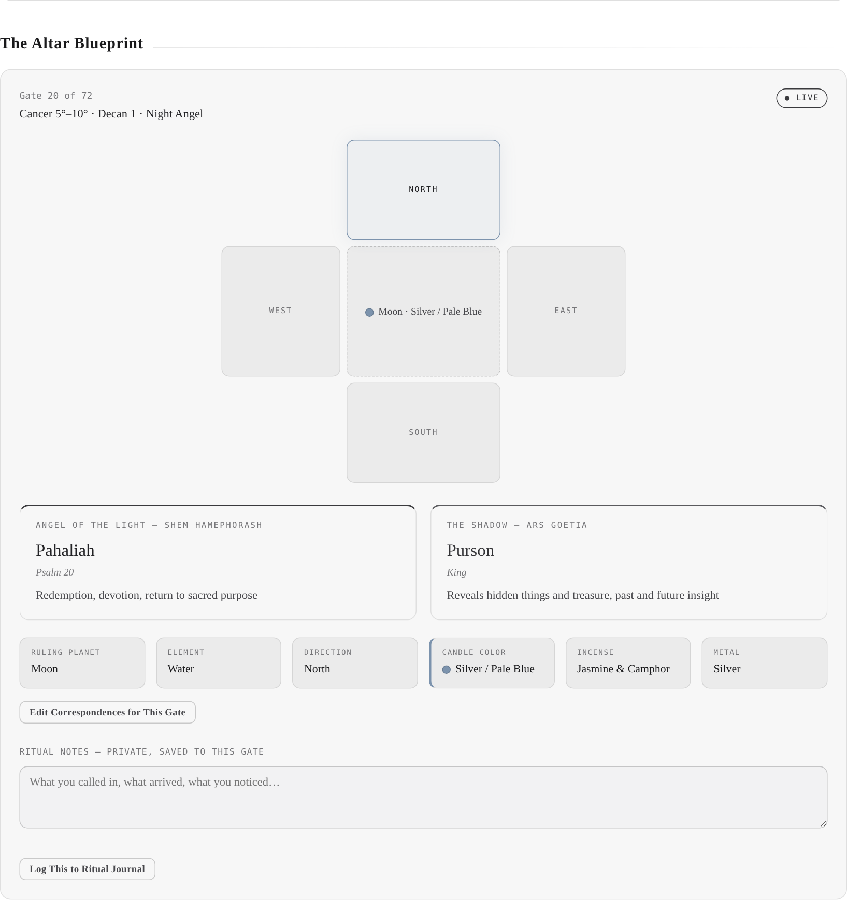
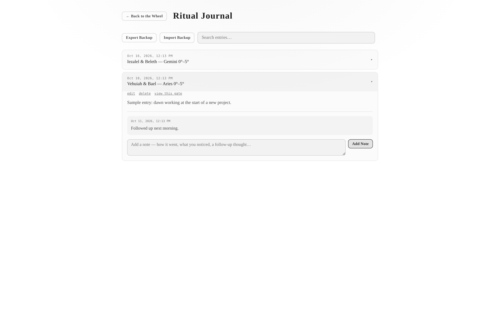
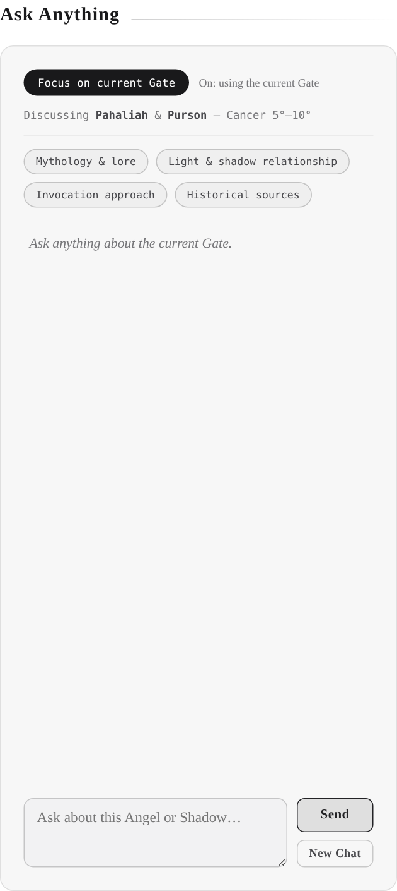
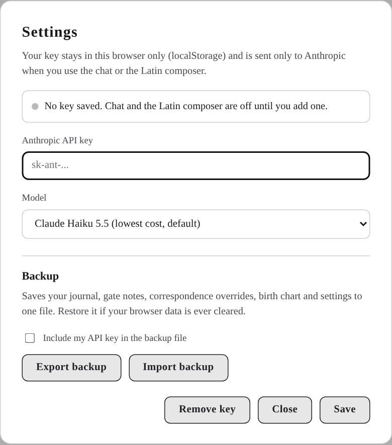

# Light & Shadow

A ritual planning tool that maps the 72 Angels of the Shem HaMephorash (the Light) to the 72 Ars Goetia entities (the Shadows) across 72 five-degree zodiac gates. It runs in your browser from a single HTML file. No install, no account, no server.

It is built for practitioners who work from a Hermetic Qabalah lens and want the information laid out clearly so they can adapt it to their own system. It gives you correspondences, timing and history. It does not hand you a script.

## What it does

**Live wheel and timing**
- A 72-gate wheel shows the active gate right now, with a countdown to the next one.
- The day runs from local sunrise to the next sunrise and is split into 72 windows of about 20 minutes.
- Hover the wheel to preview any gate. Click to jump to it.
- Check any past or future moment, or use Intent Matching to find the next six gates whose office fits what you are working on, each with a timestamp.

**Moon tracker**
- Phase, illumination, current zodiac sign, and days to the next full and new Moon.

**Your chart**
- Enter a birth date, time and city to get your Birth Angel, Heart Angel, Intelligence Angel, natal Moon and Ascendant, all marked on the wheel.
- The UTC offset fills in from the birth city, including daylight saving for that date.

**The Altar Blueprint**
- For any gate: the Angel and the Shadow with their offices, zodiac position, decan, planet, element, direction, candle color, incense, metal and Psalm.
- Every correspondence can be overridden per gate, so the tool follows your lineage.
- Private ritual notes are saved to each gate.

**Ritual Journal**
- Log a working from any gate. The journal has its own page with condensed rows that open to show the full entry.
- Notes are append-only, so you can add follow-ups without rewriting history. Search and edit are built in.

**AI features (optional, bring your own key)**
- **Ask Anything** is a chat in the right sidebar. It is general by default. Turn on "Focus on current Gate" to discuss the active Angel and Shadow.
- The chat knows today's date and can look up any past or future moment, or find when a gate next opens, instead of guessing.
- The **Latin Composer** writes a short Latin working for the selected gate and your stated intent, with English and a pronunciation line under each verse. Export it as a PDF.

## Getting started

1. Download `light-and-shadow.html` from this repo (open the file on GitHub and use the download button).
2. Open it in a current version of Chrome, Edge, Firefox or Safari.
3. Set your location by typing a city and state or a zip code under the wheel and pressing **Find My Location**, or press **Use My Location**. Until you do, the tool uses a generic 6:00 AM sunrise, so window times are only approximate.
4. Add your chart in **Your Chart** if you want your birth angels marked on the wheel.

Everything above works without an API key. Only the chat and the Latin Composer need one.

### Turning on the AI features

1. Create an API key in the [Anthropic Console](https://console.anthropic.com/).
2. Click the gear icon in the top left, paste the key and press Save.
3. A green dot on the gear and a green status line in Settings confirm a key is saved.

The model defaults to Claude Haiku 5.5, the lowest-cost option. Sonnet 5.5 and Opus 5.5 are in the same dropdown if you want higher quality. Usage is billed to your own Anthropic account.

## Your data and privacy

- All of your data lives in your browser's local storage on your own device: chart, journal, notes, overrides and settings. Nothing is sent to the author or to any server of this project.
- Your API key is stored in the same place. It is sent only to Anthropic, only when you use the chat or the Latin Composer.
- The tool makes three kinds of outside request: Anthropic's API for the AI features, OpenStreetMap's Nominatim when you search for a city, and Google Fonts for typefaces.
- Clearing your browser data erases your journal and chart. Use **Settings > Export backup** regularly and keep the file somewhere outside the browser. **Import backup** restores it, and the API key is left out of backups unless you tick the box.
- If you host this file yourself, anyone who can open the page can use whatever key is saved in their own browser. Never paste a key into a shared computer.

## How it works

- **Windows.** Local sunrise is calculated from your latitude, longitude and date. Sunrise to the next sunrise is divided into 72 equal windows. Gate 1 opens at sunrise.
- **Birth Angel** is the Angel of the five-degree gate holding the Sun at your birth. **Heart Angel** comes from a day-of-year calendar cycle, taken from the Secondary Birth Angel table published by [Angelorum](https://angelorum.co/shem-hamephorash/find-your-shem-hamephorash-birth-angels/). On the six days where two Angels share a boundary, the later Angel is used. **Intelligence Angel** is the 20-minute segment of the clock, counted from midnight, in which you were born.
- **Correspondences.** Direction follows triplicity (Fire East, Earth South, Air West, Water North). Candle color, metal and incense follow the classical planetary ruler of the sign. Psalm numbers follow Mathers' suggested 1 to 72 sequence. These are starting points and you can change any of them.
- **Astronomy.** Sun and Moon positions and the Ascendant use compact approximate formulas. They are accurate enough for five-degree gates, but a placement within a fraction of a degree of a gate boundary can land in the neighboring gate.

## Limits worth knowing

- Correspondences for the Shem and Goetia vary by lineage. The defaults here are one reasonable set. Check them against your own sources.
- The AI can be wrong. Treat its answers as research leads and verify anything you plan to rely on, especially Latin.
- A saved chart is for one person at a time. Use Export backup if you share a computer.

## Files

| Path | Purpose |
| --- | --- |
| `light-and-shadow.html` | The whole tool |
| `docs/images/` | Screenshots used in this README |

## Credits

Heart Angel calendar data follows the table published by Angelorum. Time zone lookup uses the open-source `tz-lookup` library, bundled inside the file. Place search uses OpenStreetMap Nominatim. Screenshots show sample data.
